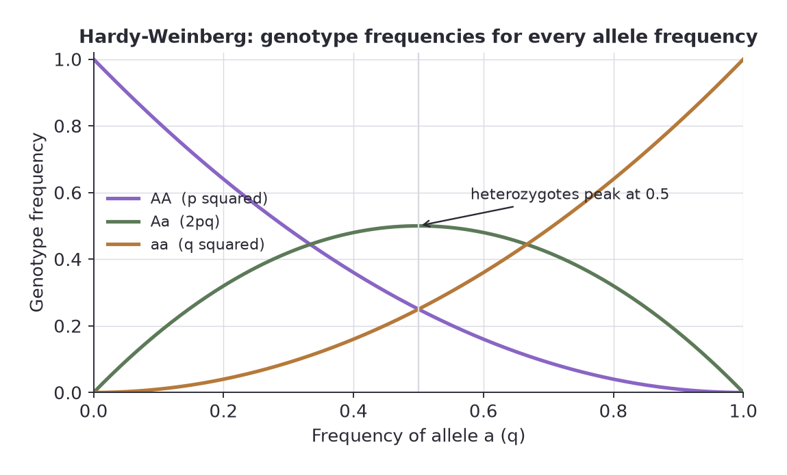
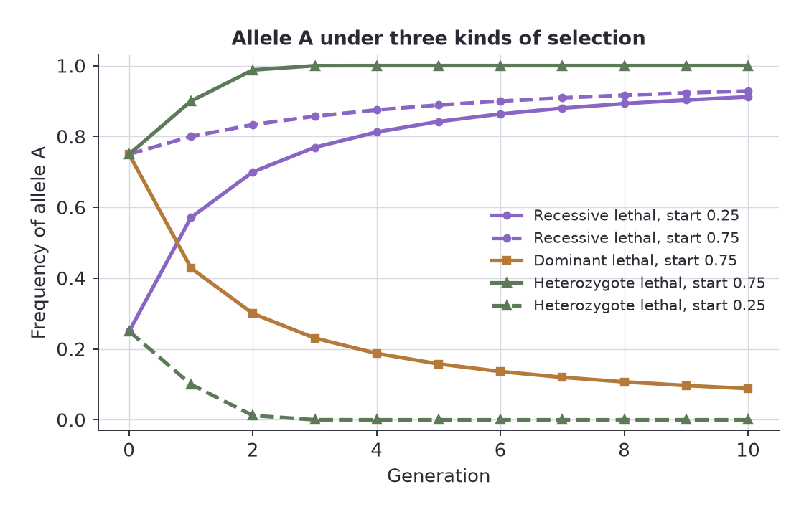
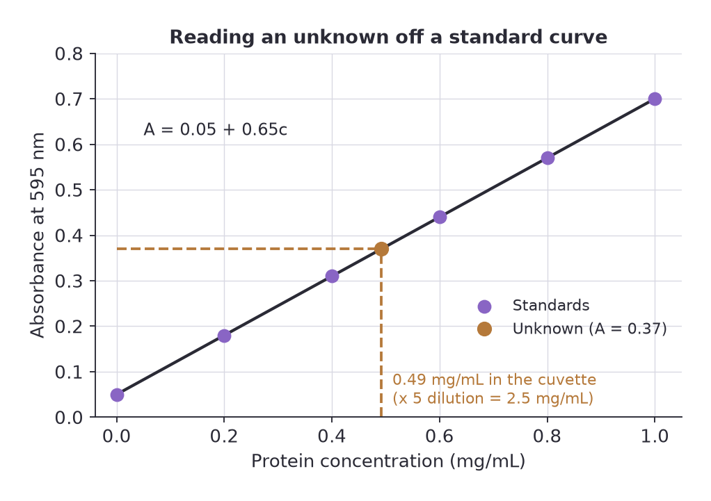





## Overview

Beyond the standard tests, biology exams lean on a small set of recurring calculations. None of them is hard on its own; the marks go to the student who sets the problem up cleanly and keeps units and assumptions straight.

---

## Relative Frequency

Relative frequency is the fraction of the total that falls in one category.


$$\text{relative frequency} = \frac{\text{number of times the event occurs}}{\text{total number of events}}$$


Multiply by 100 for a percentage. It is the starting point for allele and genotype frequencies.

### Allele frequency from genotype counts

Each individual carries two alleles, so count **alleles**, not individuals. In a sample of 400 plants there are 800 alleles. Suppose 180 are AA, 120 are Aa and 100 are aa.

- A alleles: $2 \times 180 + 120 = 480$, so $p = 480 / 800 = 0.60$
- a alleles: $2 \times 100 + 120 = 320$, so $q = 320 / 800 = 0.40$

Check: $p + q = 1$. The genotype frequency of aa is $100 / 400 = 0.25$, which is not the same thing as the allele frequency of a (0.40). Mixing up genotype and allele frequencies is one of the most common errors in population genetics.

---

## Probability

Probability runs from 0 (certain not to happen) to 1 (certain to happen).

- **Multiplication rule (AND, independent events):** multiply. The chance of two independent events both happening is $P(A) \times P(B)$.
- **Addition rule (OR, mutually exclusive events):** add. The chance of either happening is $P(A) + P(B)$.
- **Complement:** $P(\text{not } A) = 1 - P(A)$. Very useful for "at least one" questions.

### Worked example

Two healthy carriers (Aa) of a recessive condition plan to have children.

- Chance that a given child is affected (aa): $\tfrac{1}{2} \times \tfrac{1}{2} = \tfrac{1}{4}$.
- Chance that all three children are unaffected: $\left(\tfrac{3}{4}\right)^3 = \tfrac{27}{64} = 0.42$.
- Chance that **at least one** of three children is affected: $1 - 0.42 = 0.58$.

Each birth is independent, so the first child being affected does not change the chance for the second. The same multiplication logic is behind the Punnett square.

---

## Hardy-Weinberg Equilibrium

For a gene with two alleles, with frequencies $p$ (dominant, A) and $q$ (recessive, a):


$$p + q = 1 \qquad p^2 + 2pq + q^2 = 1$$


where $p^2$ is the frequency of AA, $2pq$ of Aa and $q^2$ of aa.

A population in equilibrium keeps the same allele and genotype frequencies generation after generation, provided that:

1. mating is random,
2. the population is very large (no genetic drift),
3. there is no migration,
4. there is no mutation,
5. there is no natural selection.

Real populations never meet all five, so Hardy-Weinberg works as a **null model**: the baseline against which you detect evolution.

### Worked example: finding carriers

A recessive condition affects 1 in 2,500 people.

- $q^2 = 1/2500 = 0.0004$, so $q = \sqrt{0.0004} = 0.02$
- $p = 1 - 0.02 = 0.98$
- Carriers: $2pq = 2 \times 0.98 \times 0.02 = 0.0392$, about **1 in 26**

Most copies of a rare recessive allele sit hidden in carriers, not in affected people. That is why a rare recessive disease persists, and why it cannot be quickly removed by selection.

### Testing whether a population is in equilibrium

Compare observed genotype counts with the counts Hardy-Weinberg predicts, using chi-square.

In 200 flowers there are 90 RR, 80 Rr and 30 rr.

1. Allele frequencies: $p = (2 \times 90 + 80) / 400 = 0.65$, $q = 0.35$.
2. Expected: $RR = 0.65^2 \times 200 = 84.5$; $Rr = 2 \times 0.65 \times 0.35 \times 200 = 91.0$; $rr = 0.35^2 \times 200 = 24.5$.
3. $\chi^2 = \dfrac{(90-84.5)^2}{84.5} + \dfrac{(80-91)^2}{91} + \dfrac{(30-24.5)^2}{24.5} = 0.36 + 1.33 + 1.23 = 2.92$.
4. Degrees of freedom: **categories minus 1 minus the number of parameters estimated from the data**. Here $3 - 1 - 1 = 1$, because $p$ was estimated from the sample.
5. The critical value for $df = 1$ is 3.84. Since $2.92 < 3.84$ we fail to reject $H_0$: the population is consistent with Hardy-Weinberg equilibrium.

The extra "minus one" for the estimated allele frequency is the detail most students miss.

---

## A Simple Model of Natural Selection

Hardy-Weinberg assumes every genotype survives equally. Relax that and you get a model of selection. Let $S_{AA}$, $S_{AB}$ and $S_{BB}$ be the probabilities that each genotype survives to reproduce, and $p_n$, $q_n$ the allele frequencies in generation $n$.

Genotypes arrive in proportions $p_n^2$, $2p_nq_n$ and $q_n^2$. After selection, the A alleles in the next generation come from all AA (two A each) and half the alleles of the heterozygotes. The factor of 2 for alleles cancels from top and bottom, giving:


$$p_{n+1} = \frac{S_{AA}\, p_n^2 + S_{AB}\, p_n q_n}{S_{AA}\, p_n^2 + 2 S_{AB}\, p_n q_n + S_{BB}\, q_n^2}$$


The denominator is the mean survival of the population. Set all three $S$ values to 1 and the formula collapses to $p_{n+1} = p_n$: no change, which is Hardy-Weinberg.

### Three cases worth knowing

<table>
<thead><tr><th>Case</th><th>Survival</th><th>Simplified formula</th><th>Behaviour</th></tr></thead>
<tbody>
<tr><td>Recessive lethal</td><td>$S_{BB} = 0$, others 1</td><td>$p_{n+1} = \dfrac{1}{1 + q_n}$</td><td>A rises towards 1, slowly at the end</td></tr>
<tr><td>Dominant lethal</td><td>$S_{AA} = 0$, others 1</td><td>$p_{n+1} = \dfrac{p_n}{1 + p_n}$</td><td>A falls towards 0, slowly at the end</td></tr>
<tr><td>Heterozygote lethal</td><td>$S_{AB} = 0$, others 1</td><td>$p_{n+1} = \dfrac{p_n^2}{p_n^2 + q_n^2}$</td><td>Whichever allele is commoner takes over; $p = 0.5$ is an unstable balance</td></tr>
</tbody>
</table>

### Allele A frequency over five generations

<table>
<thead><tr><th>Generation</th><th>0</th><th>1</th><th>2</th><th>3</th><th>4</th><th>5</th></tr></thead>
<tbody>
<tr><td>Recessive lethal, start 0.25</td><td>0.250</td><td>0.571</td><td>0.700</td><td>0.769</td><td>0.813</td><td>0.842</td></tr>
<tr><td>Recessive lethal, start 0.75</td><td>0.750</td><td>0.800</td><td>0.833</td><td>0.857</td><td>0.875</td><td>0.889</td></tr>
<tr><td>Dominant lethal, start 0.75</td><td>0.750</td><td>0.429</td><td>0.300</td><td>0.231</td><td>0.188</td><td>0.158</td></tr>
<tr><td>Heterozygote lethal, start 0.75</td><td>0.750</td><td>0.900</td><td>0.988</td><td>1.000</td><td>1.000</td><td>1.000</td></tr>
<tr><td>Heterozygote lethal, start 0.25</td><td>0.250</td><td>0.100</td><td>0.012</td><td>0.000</td><td>0.000</td><td>0.000</td></tr>
</tbody>
</table>

### Why the answers differ

- **Recessive lethal.** Selection removes a bb individual and its two b alleles, but most b alleles are hidden in heterozygotes where selection cannot see them. As b becomes rare, nearly all of it is in carriers, so the decline slows to a crawl. It never reaches zero in this model.
- **Dominant lethal.** Here it is the AA genotype that is lost. A falls quickly at first, but once A is rare nearly all its copies sit in surviving heterozygotes, so the decline slows.
- **Heterozygote lethal.** Both homozygotes survive and the heterozygote does not, so each generation the rarer allele is mostly paired with the commoner one and is lost in heterozygotes. Whichever allele starts above 0.5 takes over completely; 0.5 is the knife edge. This is the opposite of heterozygote advantage, where selection holds both alleles in the population.

The lesson of the whole exercise: **the outcome of selection depends on which genotype the selection acts on and where the alleles are hiding**, not only on how strong selection is.

### Reading the assumptions

Every model answer should include its assumptions: random mating, no drift, no mutation, no migration, and survival values that stay constant. State them, then say what changes if one is broken.

---

## Rates, Percentage Change and Dilutions

### Rates

A rate is a change divided by the time it took.


$$\text{rate} = \frac{\text{final value} - \text{initial value}}{\text{time}}$$


If a culture grows from 1,500 to 2,400 cells per mL over 6 hours, the average rate is $(2400 - 1500) / 6 = 150$ cells mL$^{-1}$ h$^{-1}$. Always carry the units: a rate without them is half an answer.

### Percentage change

$$\%\ \text{change} = \frac{\text{new value} - \text{old value}}{\text{old value}} \times 100$$

The same culture increased by $900 / 1500 \times 100 = 60\%$. A negative answer is a decrease. Percentage change is always relative to the **starting** value, which is why a 50% drop followed by a 50% rise does not return you to where you began.

### Dilutions

For a single dilution:

$$C_1 V_1 = C_2 V_2$$

For a **serial dilution**, the dilution factors multiply. Three successive 1 in 10 steps give $10 \times 10 \times 10 = 1000$, written $10^{-3}$. To find the original concentration, multiply the measured value by the total dilution factor. Forgetting this step is among the most common practical errors. Time-efficient dilution strategy is covered in the pipetting section of [Practical I](/resources/11-practical-1/).

---

## Standard Curves

A standard curve turns an instrument signal (absorbance, fluorescence, migration distance) into a concentration or size you actually care about. You measure samples of **known** value, plot signal against value, fit a line, and read the **unknown** off it.

### Procedure

1. Prepare standards covering a range that brackets your unknowns, including a blank (zero) standard.
2. Measure all standards and unknowns the same way, in the same run.
3. Plot signal on the y-axis against known value on the x-axis.
4. Draw the best-fit line, or use the regression equation $y = a + bx$.
5. Find the unknown's value: **interpolate** (read the x value for the measured y), by rearranging $x = (y - a)/b$.
6. Multiply by any dilution factor you used.

### Worked example: protein assay

A dye-binding assay gives the following absorbances at 595 nm for protein standards:

<table>
<thead><tr><th>Protein (mg/mL)</th><th>0</th><th>0.2</th><th>0.4</th><th>0.6</th><th>0.8</th><th>1.0</th></tr></thead>
<tbody>
<tr><td>A595</td><td>0.05</td><td>0.18</td><td>0.31</td><td>0.44</td><td>0.57</td><td>0.70</td></tr>
</tbody>
</table>

The points lie on a line $A = 0.05 + 0.65c$, where $c$ is the protein concentration in mg/mL.

An unknown sample, which had been diluted 5-fold before the measurement, gives $A = 0.37$.

- Concentration in the cuvette: $c = (0.37 - 0.05) / 0.65 = 0.49$ mg/mL
- Original concentration: $0.49 \times 5 = \mathbf{2.5\ mg/mL}$

The same logic estimates the size of a DNA fragment from how far it travelled in a gel; there the relationship is not linear, so you plot log fragment size against distance travelled to get a straight line. See [Molecular Biology Techniques](/resources/11-practical-1/molecular-biology-techniques/) for gels.

### Rules for a trustworthy curve

- **Interpolate, do not extrapolate.** An unknown outside the range of standards is not reliable. Dilute it and measure again.
- Stay in the **linear range** of the instrument. Very high absorbances flatten out and the line no longer holds.
- A good calibration line has $r^2$ very close to 1 (above 0.99 is typical). A lower value than that usually signals pipetting error, not natural variation.
- **Use the blank**: subtract it or include it as the zero point.
- Run the standards and the unknowns together.

---

## Common Exam Traps

- Counting individuals instead of alleles when computing allele frequency.
- Confusing $q^2$ (genotype frequency) with $q$ (allele frequency). The square root step is the crux.
- Using $df = \text{categories} - 1$ for a Hardy-Weinberg test and forgetting the extra parameter.
- Forgetting the dilution factor when reading off a standard curve.
- Extrapolating beyond the highest standard.
- Giving a rate with no units, or a percentage change calculated from the wrong baseline.

---

## Practice Questions

**1. In a population, 9% of individuals show a recessive trait. Find the allele frequencies and the proportion of carriers, assuming Hardy-Weinberg equilibrium.**

Model answer

$q^2 = 0.09$, so $q = 0.30$ and $p = 0.70$. Carriers $= 2pq = 2 \times 0.70 \times 0.30 = 0.42$, so 42% of the population are carriers. Homozygous dominant individuals are $p^2 = 0.49$.

**2. A sample of 400 plants has 180 AA, 120 Aa and 100 aa. Calculate the allele frequencies and the expected number of each genotype under Hardy-Weinberg.**

Model answer

$p = (360 + 120)/800 = 0.60$, $q = 0.40$. Expected: AA $= 0.36 \times 400 = 144$; Aa $= 0.48 \times 400 = 192$; aa $= 0.16 \times 400 = 64$. The observed counts (180, 120, 100) are very different, with far too few heterozygotes, so the population is not in Hardy-Weinberg equilibrium (possible causes include inbreeding or non-random mating).

**3. Using the selection model with $S_{BB} = 0$ and $S_{AA} = S_{AB} = 1$, calculate $p_1$ when $p_0 = 0.5$.**

Model answer

$p_1 = 1/(1 + q_0) = 1/(1 + 0.5) = 0.667$. The A allele rises because every bb individual is removed before reproducing.

**4. Why does a lethal recessive allele persist at low frequency for many generations, even though it is lethal in homozygotes?**

Model answer

When the allele is rare, almost every copy sits in a heterozygote, and heterozygotes are not affected. Only the very few homozygotes ($q^2$, a tiny number) are removed each generation, so selection has little to act on. The allele is shielded from selection in carriers.

**5. Two carriers of a recessive condition have two children. What is the probability that both are unaffected, and what is the probability that at least one is affected?**

Model answer

Each child is unaffected with probability 3/4. Both unaffected: $(3/4)^2 = 9/16 = 0.5625$. At least one affected: $1 - 9/16 = 7/16 = 0.4375$.

**6. A standard curve fits $A = 0.05 + 0.65c$. A sample diluted 10-fold reads $A = 0.28$. What is the original concentration? And what should you do if another sample reads $A = 0.95$?**

Model answer

$c = (0.28 - 0.05)/0.65 = 0.354$ mg/mL in the cuvette, times 10 gives **3.5 mg/mL** originally. An absorbance of 0.95 lies above the highest standard (0.70), so reading it off the line would be extrapolation. Dilute the sample and measure again so that the reading falls within the standards.

**7. A culture is counted at 3,000 cells per mL and, 4 hours later, at 1,800 cells per mL. Give the average rate of change and the percentage change.**

Model answer

Rate $= (1800 - 3000)/4 = -300$ cells mL$^{-1}$ h$^{-1}$, a decrease of 300 cells per mL each hour. Percentage change $= -1200/3000 \times 100 = -40\%$.

  
Log in to keep reading - free, and takes a few seconds.

  <a class="papers-nav-btn papers-nav-next" id="article-gate-cta-link" href="/account/">Log in to keep reading</a>

