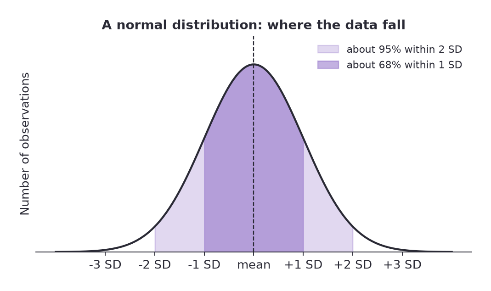
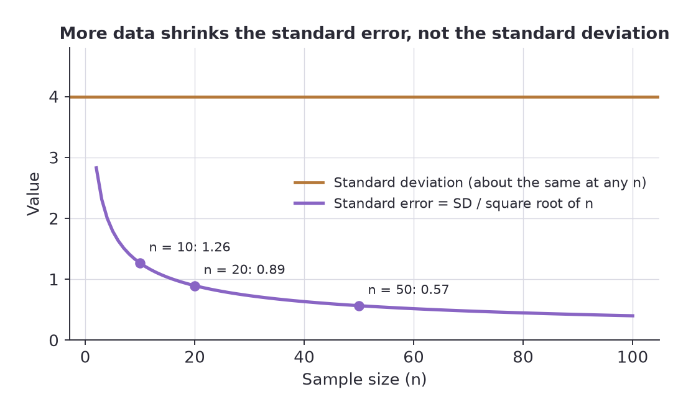
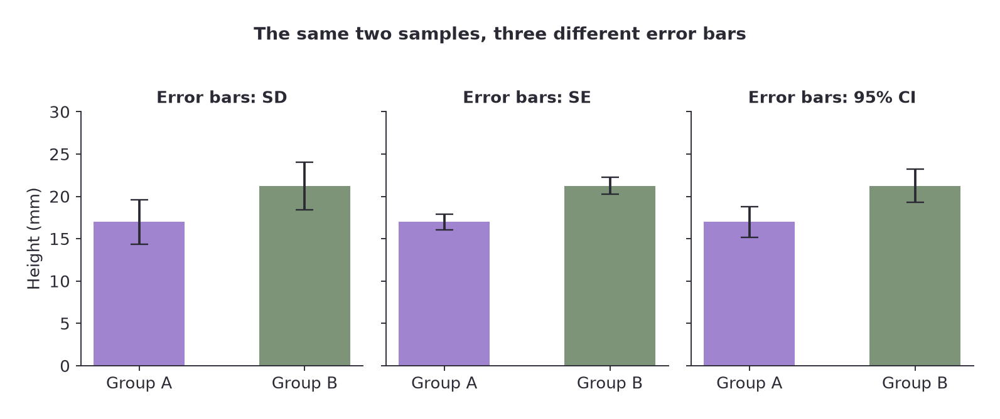





## Overview

Descriptive statistics answer two questions about a sample: **where is the middle** and **how spread out is it**. A third question follows from them: **how well does this sample tell me about the whole population?** That is what standard error and confidence intervals are for.

Before any calculation, plot the data. The shape of the distribution decides which summary is honest.

---

## Graphing: Pick the Right Chart, Then Label It Properly

The wrong chart type is one of the most common ways to lose marks on a data question. Match the graph to the question you are asking.

<table>
<thead><tr><th>Graph</th><th>Use it for</th><th>Biology example</th></tr></thead>
<tbody>
<tr><td>Bar graph</td><td>Comparing a value between separate groups</td><td>Mean enzyme activity at three pH values</td></tr>
<tr><td>Histogram</td><td>Showing how counts are distributed across numerical ranges (bins) of one variable</td><td>Number of plants with 0 to 9, 10 to 19, 20 to 29 trichomes</td></tr>
<tr><td>Line graph</td><td>Change in one variable over a continuous variable such as time</td><td>Population size each week</td></tr>
<tr><td>Scatter plot</td><td>Whether two numerical variables are related</td><td>Leaf length against leaf area</td></tr>
<tr><td>Pie chart</td><td>Parts of a single whole</td><td>Share of cells in each stage of mitosis</td></tr>
</tbody>
</table>

A bar graph has gaps between bars because the categories are separate. A histogram has no gaps because the bins are consecutive slices of one number line. Do not confuse them.

### Rules for a graph that earns full marks

- **Dependent variable on the y-axis, independent variable on the x-axis.** The thing you changed goes along the bottom; the thing you measured goes up the side.
- **Title that says what was measured and under what conditions**, not just "Results".
- **Both axes labelled, with units in brackets**, for example "Time (min)".
- **Even, sensible scales.** Equal steps along each axis, chosen to fill the grid. The scale does not have to start at zero if all the data sit far from it.
- **Plot the points, then draw the line.** A line of best fit covers only the range of the data; do not add arrowheads suggesting it continues, and do not extrapolate without saying so.
- **Error bars when you plot means**, and say in the caption what they represent (standard deviation, standard error or 95% confidence interval).
- **A scatter plot, not a line graph, when you are testing for a relationship** between two measured variables. Join points with a line only when the order of the x values genuinely means something, such as time.

---

## Measures of the Middle

### Mean

The mean is the sum of all values divided by how many there are.


$$\bar{x} = \frac{\sum x_i}{n}$$


Here $\bar{x}$ is the **sample** mean, which is your estimate of the unknown **population** mean $\mu$.

### Median

Sort the values and take the middle one. With an even number of values, average the middle two. The median ignores extreme values, so it is the better summary when the data are skewed or contain an outlier.

### Mode

The most frequent value. It is rarely used as a summary in biology, but it matters when a distribution has two peaks (bimodal), for example body size in a species with two distinct castes. A single mean there would describe nobody.

### Which one?

<table>
<thead><tr><th>Situation</th><th>Report</th></tr></thead>
<tbody>
<tr><td>Roughly symmetric, bell-shaped data</td><td>Mean</td></tr>
<tr><td>Skewed data or a clear outlier</td><td>Median</td></tr>
<tr><td>Two peaks in the histogram</td><td>Describe both modes; do not summarise with one number</td></tr>
</tbody>
</table>

### Worked example: mean, median and mode

Eight seedlings were measured after two weeks (height in mm): 14, 17, 15, 19, 16, 18, 15, 22.

- Sum = 136, so mean = 136 / 8 = **17.0 mm**.
- Sorted: 14, 15, 15, 16, 17, 18, 19, 22. The middle two are 16 and 17, so the median = **16.5 mm**.
- 15 appears twice and nothing else does, so the mode = **15 mm**.

The mean sits slightly above the median because the tallest seedling (22) pulls it up a little.

### Worked example: when the mean misleads

Eight mice were timed finding food in a maze (seconds): 31, 29, 33, 30, 28, 32, 29, 95.

The mean is 38.4 s, but seven of the eight mice finished within 28 to 33 s. The median is **30.5 s**, which describes the typical mouse far better. One very slow animal dragged the mean up by almost eight seconds. Always ask whether an outlier is a recording error, a genuine extreme or part of a second group before you decide what to do with it.

---

## Measures of Spread

### Range

Largest value minus smallest value. Quick, but it depends entirely on the two most extreme values, so it says nothing about the values in between.

### Variance and standard deviation

The standard deviation $s$ measures how far, on average, values lie from the mean. Calculate it in six steps:

1. Find the mean $\bar{x}$.
2. Subtract the mean from every value: $x_i - \bar{x}$.
3. Square each difference, so negatives do not cancel positives.
4. Add the squares: $\sum (x_i - \bar{x})^2$.
5. Divide by the degrees of freedom, $n - 1$. The result is the **variance**, $s^2$.
6. Take the square root. The result is the **standard deviation**, $s$.


$$s = \sqrt{\frac{\sum (x_i - \bar{x})^2}{n - 1}}$$


#### Worked example

Using the seedling heights above (mean 17.0):

<table>
<thead><tr><th>Height (x)</th><th>x minus mean</th><th>Squared</th></tr></thead>
<tbody>
<tr><td>14</td><td>-3</td><td>9</td></tr>
<tr><td>17</td><td>0</td><td>0</td></tr>
<tr><td>15</td><td>-2</td><td>4</td></tr>
<tr><td>19</td><td>2</td><td>4</td></tr>
<tr><td>16</td><td>-1</td><td>1</td></tr>
<tr><td>18</td><td>1</td><td>1</td></tr>
<tr><td>15</td><td>-2</td><td>4</td></tr>
<tr><td>22</td><td>5</td><td>25</td></tr>
<tr><td><strong>Sum</strong></td><td>0</td><td><strong>48</strong></td></tr>
</tbody>
</table>

The differences always sum to zero, which is a handy check on your arithmetic.

- Variance: $s^2 = 48 / 7 = 6.86$
- Standard deviation: $s = \sqrt{6.86} = 2.62$ mm

Report the result as **17.0 ± 2.6 mm (mean ± SD, n = 8)**.

### What standard deviation tells you

If the data are roughly normally distributed (a symmetric bell shape):

- about **68%** of values fall within 1 SD of the mean,
- about **95%** fall within 2 SD of the mean.

For the seedlings, you would expect roughly two thirds of such plants to be between 14.4 and 19.6 mm tall.

Two points that catch people out:

- **Standard deviation describes the spread of the data. It is not the error of the measurement.**
- **Collecting more data does not make the SD smaller.** It makes the SD a more reliable estimate of the true spread, and it may go up or down.

### Why divide by n - 1?

The mean you calculated was itself worked out from the same data, so the values are not all independent of it. Once the mean is fixed, only $n - 1$ values are free to vary; the last is forced. Picture five measurements with a known mean of 10 and the first four being 8, 9, 10, 12: the fifth must be 11. That count of free values, $n - 1$, is the **degrees of freedom** (df), and dividing by it removes the bias that dividing by $n$ would give when estimating the population's spread from a sample. The idea comes back in the t-test and chi-square, each with its own rule for df.

---

## How Sure Are You of the Mean?

The standard deviation tells you about the spread of individual values. A different question is how close your sample mean is likely to be to the true population mean. Take another sample and you would get a slightly different mean; **standard error (SE)** quantifies how much sample means vary.


$$SE = \frac{s}{\sqrt{n}}$$


Unlike the SD, the SE **always shrinks as the sample gets bigger**, because $\sqrt{n}$ is in the denominator. With $s = 4.0$:

<table>
<thead><tr><th>n</th><th>SE</th></tr></thead>
<tbody>
<tr><td>10</td><td>1.26</td></tr>
<tr><td>20</td><td>0.89</td></tr>
<tr><td>50</td><td>0.57</td></tr>
</tbody>
</table>

Note that to halve the SE you need four times as many measurements, not twice as many.

### 95% confidence interval


$$95\%\ \text{CI} = \bar{x} \pm 1.96 \times SE \approx \bar{x} \pm 2 \times SE$$


It is read as: the interval within which the true population mean lies with about 95% confidence. For the seedlings, $SE = 2.62 / \sqrt{8} = 0.93$, so the 95% CI is $17.0 \pm 1.8$, that is **15.2 to 18.8 mm**.

(For very small samples the multiplier 1.96 is too small; the t-distribution gives a bigger one. For exam purposes, using 2 is normally what is expected.)

### SD, SE or CI: which error bar?

<table>
<thead><tr><th>Error bar</th><th>It shows</th><th>Changes with larger n?</th></tr></thead>
<tbody>
<tr><td>Standard deviation</td><td>Spread of the individual measurements</td><td>No, stays roughly the same</td></tr>
<tr><td>Standard error</td><td>Uncertainty in the mean (about 68% confidence)</td><td>Yes, gets smaller</td></tr>
<tr><td>95% confidence interval</td><td>Uncertainty in the mean (about 95% confidence)</td><td>Yes, gets smaller</td></tr>
</tbody>
</table>

A graph without a statement of which one is used cannot be interpreted. Always say in the caption.

### Reading error bars to judge a difference

- **95% CI bars that do not overlap** strongly suggest the two means differ.
- **95% CI bars that overlap a lot**, especially when each interval contains the other mean, suggest the difference could be chance.
- **SE bars that do not overlap** are not enough on their own to claim a significant difference, because SE bars are only about half as wide as 95% CI bars.
- **Anything in between needs a test**, which is the job of the [t-test](../inferential-tests/).

---

## Common Exam Traps

- Dividing by $n$ instead of $n - 1$ when computing a sample SD. Check whether your calculator is in sample or population mode.
- Quoting the SE when asked for the SD, or the reverse.
- Reporting a mean to many more decimal places than the measurements justify.
- Using a bar graph for a continuous distribution (should be a histogram) or a line graph for unrelated categories.
- Leaving the units off an axis.
- Summarising a skewed or two-peaked data set with a mean.
- Saying the SD "goes down with more data".

---

## Practice Questions

**1. A student counts stomata in an equal field of view on six leaves: 52, 48, 55, 50, 45, 58. Calculate the mean, the median, the standard deviation and the standard error.**

Model answer

Mean = 308 / 6 = **51.3**. Sorted values: 45, 48, 50, 52, 55, 58, so the median is (50 + 52) / 2 = **51.0**.

Squared differences from 51.33: 0.4 + 11.1 + 13.4 + 1.8 + 40.1 + 44.4 = 111.3. Then $s^2 = 111.3 / 5 = 22.3$ and $s = \mathbf{4.72}$.

$SE = 4.72 / \sqrt{6} = \mathbf{1.93}$.

**2. For the same data, give the 95% confidence interval and say what it tells you.**

Model answer

$51.3 \pm 2 \times 1.93 = 51.3 \pm 3.9$, so roughly **47.5 to 55.2 stomata**. We can be about 95% confident that the mean number of stomata in the whole population of such leaves lies in that range. It is a statement about the mean, not about individual leaves, so individual leaves may well fall outside it.

**3. Seven plants have heights (cm) of 6.2, 5.8, 6.9, 6.1, 7.4, 6.0 and 6.6. Which is larger, the mean or the median, and why might that be?**

Model answer

Mean = 45.0 / 7 = 6.43 cm. Median = 6.2 cm (sorted: 5.8, 6.0, 6.1, 6.2, 6.6, 6.9, 7.4). The mean is larger because the data have a longer tail of tall plants (6.9 and 7.4), which pull the mean upward but do not affect the median. The distribution is slightly right-skewed.

**4. Two data sets have the same standard deviation of 3.3. Set A has 9 observations and Set B has 36. Compare their standard errors and explain.**

Model answer

$SE_A = 3.3 / \sqrt{9} = 1.10$ and $SE_B = 3.3 / \sqrt{36} = 0.55$. Set B has four times as many observations, so its SE is half as large. A bigger sample gives a more precise estimate of the mean even when the individual measurements are just as variable.

**5. A graph shows two bars with SE error bars that just fail to overlap. A classmate says the difference is therefore significant. Respond.**

Model answer

Non-overlapping SE bars are suggestive but not conclusive, because SE bars cover only about 68% confidence and are roughly half as wide as 95% CI bars. Two means with non-overlapping SE bars can still have overlapping 95% intervals. A proper test such as the t-test is needed, or the graph should be redrawn with 95% CI bars.

**6. Name the best graph type for each: (a) proportion of a blood sample made up of each cell type, (b) body mass against age in months, (c) number of seedlings in each 5 cm height class, (d) mean growth rate on four different fertilisers.**

Model answer

(a) Pie chart. (b) Line graph if the same individuals are followed over time, scatter plot with a line of best fit if you are testing a relationship. (c) Histogram. (d) Bar graph with error bars.

  
Log in to keep reading - free, and takes a few seconds.

  <a class="papers-nav-btn papers-nav-next" id="article-gate-cta-link" href="/account/">Log in to keep reading</a>

