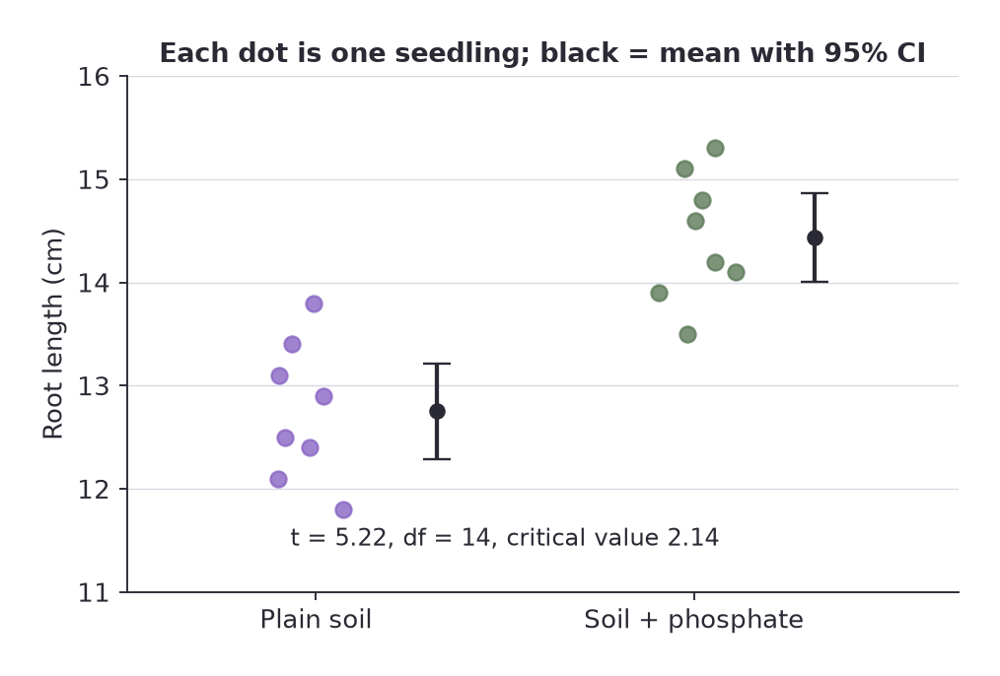
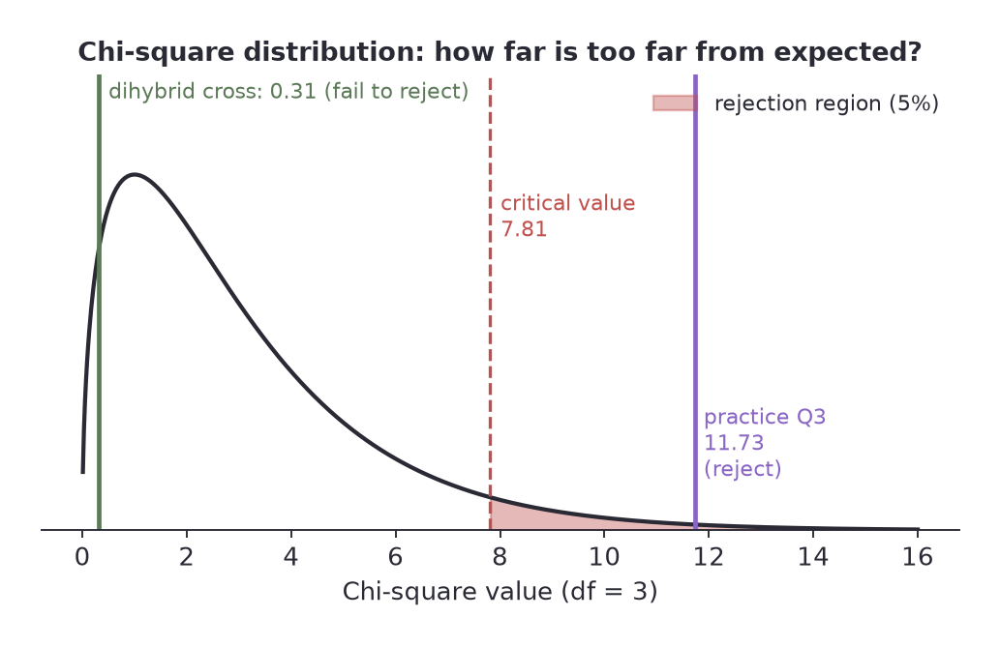
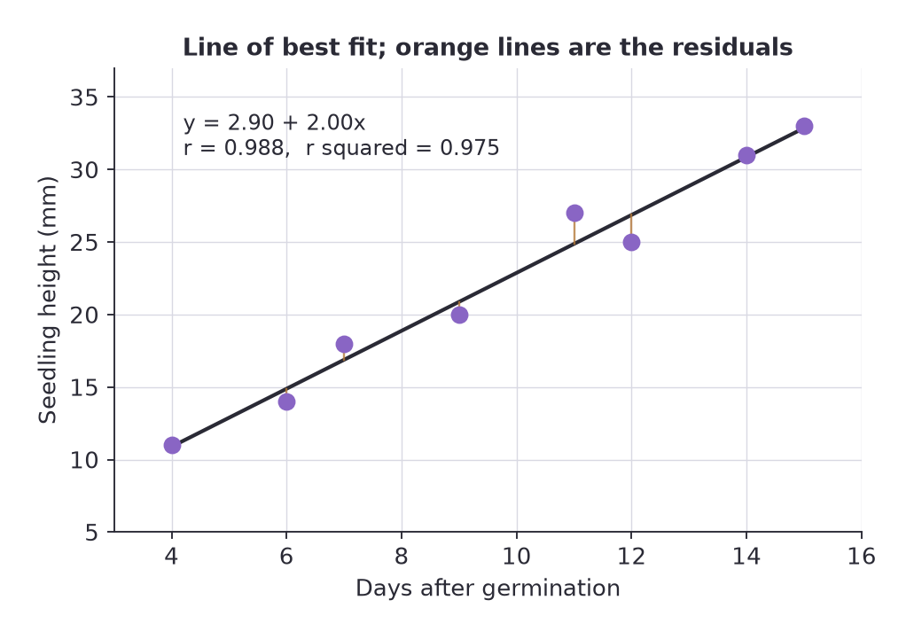





## Overview

Descriptive statistics summarise the sample in front of you. **Inferential statistics** ask whether what you see in the sample is probably true of the population, or whether chance alone could have produced it.

Suppose ten plants given extra nitrogen average 13.2 cm and ten plants without it average 11.9 cm. Is nitrogen helping, or did you simply happen to pick slightly taller plants for one group? A statistical test puts a number on that doubt.

This page covers the three tests that dominate biology exams:

<table>
<thead><tr><th>Test</th><th>Data</th><th>Question it answers</th></tr></thead>
<tbody>
<tr><td>Two-sample t-test</td><td>Measurements from two groups</td><td>Do the two group means differ?</td></tr>
<tr><td>Chi-square</td><td>Counts in categories</td><td>Do the observed counts differ from the expected counts?</td></tr>
<tr><td>Correlation and regression</td><td>Pairs of measurements</td><td>Are two variables associated, and how strongly?</td></tr>
</tbody>
</table>

---

## The Logic of Hypothesis Testing

Every test follows the same five steps.

1. **State the null hypothesis ($H_0$).** The "nothing is going on" claim: no difference, no association, observed matches expected. Any difference in your data is due to chance.
2. **State the alternative hypothesis ($H_1$).** There is a difference, or an association.
3. **Choose the significance level $\alpha$** before you look at the result. In biology this is almost always **0.05**.
4. **Calculate a test statistic** ($t$, $\chi^2$ or $r$) and compare it with the **critical value** for your degrees of freedom.
5. **Decide.** If the statistic is more extreme than the critical value, **reject $H_0$**. Otherwise **fail to reject $H_0$**.

What $\alpha = 0.05$ means: if the null hypothesis were true, there would be only a 5% chance (or less) of getting a test statistic this extreme from random sampling alone. When we reject, we are accepting a 5% risk of being wrong.

### The wording matters

- Say **"reject the null hypothesis"** or **"fail to reject the null hypothesis"**. Not "accept".
- A test **never proves** the alternative hypothesis. It only shows that the data are hard to explain by chance.
- **Failing to reject does not mean no difference exists.** It means you do not have enough evidence, which with a small sample is a very common situation.
- **Statistically significant is not the same as biologically important.** A tiny difference in a huge sample can be significant yet trivial.
- A result at the 0.01 level is called highly significant; it means the chance explanation is even less likely.

---

## The Two-Sample t-Test

Use it to compare the **means of two independent groups** of measurements. It assumes the data in each group are roughly normally distributed.


$$t = \frac{|\bar{x}_1 - \bar{x}_2|}{\sqrt{\dfrac{s_1^2}{n_1} + \dfrac{s_2^2}{n_2}}} \qquad df = n_1 + n_2 - 2$$


The numerator is the difference between the means. The denominator is the standard error of that difference. So $t$ asks: **how many standard errors apart are the two means?** The bigger $t$ is, the harder the difference is to blame on chance.

### Steps

1. Calculate the mean of each group, subtract, and take the absolute value.
2. Calculate each group's variance $s^2$ (the SD squared), divide it by that group's $n$, add the two results and take the square root.
3. Divide the difference by that standard error to get $t$.
4. Work out $df = n_1 + n_2 - 2$ and look up the critical value.
5. If $t >$ critical value, reject $H_0$: the means are significantly different.

### Critical t values ($\alpha = 0.05$, two-tailed)

<table>
<thead><tr><th>df</th><th>t crit</th><th>df</th><th>t crit</th><th>df</th><th>t crit</th></tr></thead>
<tbody>
<tr><td>1</td><td>12.71</td><td>8</td><td>2.31</td><td>20</td><td>2.09</td></tr>
<tr><td>2</td><td>4.30</td><td>9</td><td>2.26</td><td>25</td><td>2.06</td></tr>
<tr><td>3</td><td>3.18</td><td>10</td><td>2.23</td><td>30</td><td>2.04</td></tr>
<tr><td>4</td><td>2.78</td><td>12</td><td>2.18</td><td>40</td><td>2.02</td></tr>
<tr><td>5</td><td>2.57</td><td>14</td><td>2.14</td><td>60</td><td>2.00</td></tr>
<tr><td>6</td><td>2.45</td><td>16</td><td>2.12</td><td>120</td><td>1.98</td></tr>
<tr><td>7</td><td>2.36</td><td>18</td><td>2.10</td><td>very large</td><td>1.96</td></tr>
</tbody>
</table>

Note how the critical value falls towards 1.96 as the sample grows. Small samples need a larger $t$ to convince you.

### Worked example

Root length (cm) of eight seedlings grown in plain soil and eight grown in soil with added phosphate:

- Plain soil: 12.1, 13.4, 11.8, 12.9, 13.1, 12.4, 13.8, 12.5. Mean = 12.75, $s^2 = 0.454$.
- Phosphate: 14.2, 13.9, 15.1, 14.6, 13.5, 14.8, 15.3, 14.1. Mean = 14.44, $s^2 = 0.383$.

$H_0$: mean root length is the same in both soils.

- Difference of means: $|12.75 - 14.44| = 1.69$
- Standard error: $\sqrt{0.454/8 + 0.383/8} = \sqrt{0.0568 + 0.0478} = 0.323$
- $t = 1.69 / 0.323 = 5.22$
- $df = 8 + 8 - 2 = 14$, so the critical value is 2.14.

Since $5.22 > 2.14$, we **reject $H_0$**. Root length differs significantly between the two soils, and the phosphate group is longer. That supports (does not prove) the hypothesis that phosphate promotes root growth.

### Things to remember

- This is the version for **independent** samples: different individuals in each group. If the same individuals are measured twice (before and after), you need a **paired t-test**, which works on the differences within each pair.
- The groups do not have to be the same size.
- **Count data and percentages are usually not normally distributed.** With small samples or skewed data the t-test can mislead.
- A significant t-test comes after you plot the data and check that the means are even a sensible summary.

---

## The Chi-Square Test

Use it when your data are **counts in categories**, for example offspring of each phenotype, or animals on each side of a choice chamber. It compares the **observed** counts ($o$) with the counts **expected** if the null hypothesis were true ($e$).


$$\chi^2 = \sum \frac{(o - e)^2}{e} \qquad df = \text{number of categories} - 1$$


Each category contributes how far off it is, squared (so signs do not cancel) and scaled by the expected value (so a miss of 5 matters more where you expected 10 than where you expected 1,000).

### Steps

1. State $H_0$ and work out the **expected counts**. Multiply the total number of individuals by each expected proportion.
2. For each category calculate $(o - e)^2 / e$.
3. Add them up to get $\chi^2$.
4. $df$ = categories minus 1. Look up the critical value.
5. If $\chi^2 >$ critical value, reject $H_0$.

### Critical chi-square values

<table>
<thead><tr><th>df</th><th>p = 0.05</th><th>p = 0.01</th></tr></thead>
<tbody>
<tr><td>1</td><td>3.84</td><td>6.63</td></tr>
<tr><td>2</td><td>5.99</td><td>9.21</td></tr>
<tr><td>3</td><td>7.81</td><td>11.34</td></tr>
<tr><td>4</td><td>9.49</td><td>13.28</td></tr>
<tr><td>5</td><td>11.07</td><td>15.09</td></tr>
<tr><td>6</td><td>12.59</td><td>16.81</td></tr>
</tbody>
</table>

### Rules that keep the test valid

- Use **raw counts only**. Never percentages, proportions or averages. Converting changes the sample size and breaks the test.
- Expected counts should not be tiny. A common rule of thumb is at least 5 in every category.
- Categories must be mutually exclusive and each individual counted once.
- Large samples make it easier to detect a real deviation; small samples make it hard.

### Worked example 1: a monohybrid cross

A cross of two heterozygous tall pea plants gives 200 offspring: 148 tall and 52 short. Is this consistent with a 3:1 ratio?

$H_0$: the offspring follow a 3:1 ratio, so the expected counts are 150 tall and 50 short.

<table>
<thead><tr><th>Phenotype</th><th>o</th><th>e</th><th>(o - e)</th><th>(o - e)^2 / e</th></tr></thead>
<tbody>
<tr><td>Tall</td><td>148</td><td>150</td><td>-2</td><td>0.027</td></tr>
<tr><td>Short</td><td>52</td><td>50</td><td>2</td><td>0.080</td></tr>
<tr><td colspan="4"><strong>chi-square</strong></td><td><strong>0.107</strong></td></tr>
</tbody>
</table>

$df = 2 - 1 = 1$, critical value 3.84. Since $0.107 < 3.84$ we **fail to reject $H_0$**: the data fit a 3:1 ratio.

### Worked example 2: a dihybrid cross with four categories

A dihybrid cross gives 160 offspring: 92, 31, 28 and 9 in the four phenotype classes. Expected under 9:3:3:1 are $160 \times 9/16 = 90$, $160 \times 3/16 = 30$, 30 and $160 \times 1/16 = 10$.

$\chi^2 = \dfrac{(92-90)^2}{90} + \dfrac{(31-30)^2}{30} + \dfrac{(28-30)^2}{30} + \dfrac{(9-10)^2}{10} = 0.044 + 0.033 + 0.133 + 0.100 = 0.31$

$df = 4 - 1 = 3$, critical value 7.81. We fail to reject $H_0$: the two genes are consistent with independent assortment.

### Worked example 3: a choice chamber

100 woodlice are placed in the middle of a chamber with a damp side and a dry side. After 10 minutes 68 are on the damp side and 32 are on the dry side. If they have no preference you expect 50 and 50.

$\chi^2 = \dfrac{(68-50)^2}{50} + \dfrac{(32-50)^2}{50} = 6.48 + 6.48 = 12.96$

$df = 1$, critical value 3.84. Since $12.96 > 3.84$ (and it is also above 6.63) we **reject $H_0$**: woodlice are not distributing at random, and the data support a preference for the damp side.

---

## Correlation and Regression

Use these when each individual gives you **two** measurements and you want to know whether they are related.

### Correlation coefficient

Pearson's $r$ runs from $-1$ to $+1$.


$$r = \frac{\sum (x_i - \bar{x})(y_i - \bar{y})}{(n-1)\, s_x s_y}$$


<table>
<thead><tr><th>r</th><th>Meaning</th></tr></thead>
<tbody>
<tr><td>+1</td><td>Perfect positive relationship: y rises as x rises</td></tr>
<tr><td>0</td><td>No linear relationship</td></tr>
<tr><td>-1</td><td>Perfect negative relationship: y falls as x rises</td></tr>
</tbody>
</table>

$H_0$: there is no correlation ($r = 0$ in the population). Compare $|r|$ with the critical value for $df = n - 2$ (number of pairs minus 2).

<table>
<thead><tr><th>df</th><th>r crit (0.05)</th><th>df</th><th>r crit (0.05)</th></tr></thead>
<tbody>
<tr><td>2</td><td>0.950</td><td>8</td><td>0.632</td></tr>
<tr><td>3</td><td>0.878</td><td>10</td><td>0.576</td></tr>
<tr><td>4</td><td>0.811</td><td>12</td><td>0.532</td></tr>
<tr><td>5</td><td>0.754</td><td>15</td><td>0.482</td></tr>
<tr><td>6</td><td>0.707</td><td>20</td><td>0.423</td></tr>
<tr><td>7</td><td>0.666</td><td>30</td><td>0.349</td></tr>
</tbody>
</table>

If $|r|$ is bigger than the critical value, the correlation is statistically significant. Notice that with few data points even a high $r$ may fail the test, and with many points a weak $r$ can pass.

### Coefficient of determination, $r^2$

The square of $r$ is the **fraction of the variation in y that is accounted for by x**. An $r$ of $0.9$ gives $r^2 = 0.81$: 81% of the variation in y is explained by its relationship with x, and 19% is not. In biological data $r^2 = 0.5$ can already be a strong finding; for a calibration curve you expect $r^2$ above 0.99.

### Correlation is not causation

Two variables can move together because one causes the other, because both are driven by a third variable, or by coincidence. Correlation alone cannot tell you which. Ice cream sales and drowning deaths rise together because both rise in hot weather.

### The line of best fit

The least-squares line $y = a + bx$ is the line that minimises the squared vertical distances to the points.


$$b = \frac{\sum (x_i - \bar{x})(y_i - \bar{y})}{\sum (x_i - \bar{x})^2} \qquad a = \bar{y} - b\bar{x}$$


The slope $b$ is the change in y per unit change in x, with units (for example mm per day). The intercept $a$ is the predicted y when $x = 0$, which may not be meaningful if zero lies outside your data. Your calculator's linear regression mode gives $a$, $b$ and $r$ directly; learn it.

### Worked example

Seedling height was recorded on eight days after germination.

<table>
<thead><tr><th>Day (x)</th><th>4</th><th>6</th><th>7</th><th>9</th><th>11</th><th>12</th><th>14</th><th>15</th></tr></thead>
<tbody>
<tr><td>Height, mm (y)</td><td>11</td><td>14</td><td>18</td><td>20</td><td>27</td><td>25</td><td>31</td><td>33</td></tr>
</tbody>
</table>

From the data: $\bar{x} = 9.75$, $\bar{y} = 22.4$, $s_x = 3.92$, $s_y = 7.93$.

- $r = 0.988$ and $r^2 = 0.975$
- Slope $b = 2.00$ mm per day, intercept $a = 2.90$ mm, so $y = 2.90 + 2.00x$
- $df = 8 - 2 = 6$, critical $r = 0.707$. Since $0.988 > 0.707$ we reject $H_0$: the association is significant.

About 97.5% of the variation in height is accounted for by age in days. The line holds between day 4 and day 15; do not use it to predict height at day 60.

---

## Choosing the Right Test: A Checklist

1. Are my data **counts in categories**? Use chi-square.
2. Are they **measurements in two groups**? Use the t-test.
3. Do I have **two measurements per individual** and want to know if they track each other? Use correlation, and regression if I need the line.
4. Did I plot the data first and does the test even suit what the plot shows?
5. Did I state $H_0$, choose $\alpha$, compute the statistic, compare with the correct critical value and write a conclusion in words?

---

## Common Exam Traps

- Running chi-square on percentages.
- Using $df = n - 1$ in a t-test (it is $n_1 + n_2 - 2$ here) or $df = n$ in chi-square.
- Using the wrong direction: if the statistic is **smaller** than the critical value you do **not** reject.
- Concluding that a non-significant result proves there is no effect.
- Treating a significant correlation as proof of cause.
- Extrapolating the line of best fit beyond the data.
- Forgetting to take the absolute value of the difference in means.

---

## Practice Questions

**1. Two groups of 12 plants are given different light intensities. Group A has mean dry mass 24.1 g (s = 3.2); Group B has mean 21.4 g (s = 2.8). Test whether they differ at the 0.05 level.**

Model answer

$SE = \sqrt{3.2^2/12 + 2.8^2/12} = \sqrt{0.853 + 0.653} = 1.227$. Difference $= 2.7$. $t = 2.7 / 1.227 = 2.20$.

$df = 12 + 12 - 2 = 22$, critical value 2.07 (between 2.09 at df 20 and 2.06 at df 25). Since $2.20 > 2.07$ we reject $H_0$: the group means differ significantly. It is only a modest margin, so the conclusion deserves a cautious wording.

**2. A cross is expected to give a 1:2:1 genotype ratio. Out of 120 offspring you observe 26, 58 and 36. Do the data fit?**

Model answer

Expected: 30, 60, 30. $\chi^2 = 16/30 + 4/60 + 36/30 = 0.533 + 0.067 + 1.200 = 1.80$. $df = 3 - 1 = 2$, critical value 5.99. Since $1.80 < 5.99$ we fail to reject $H_0$. The data fit a 1:2:1 ratio.

**3. A dihybrid cross gives 108, 30, 16 and 6 offspring in the four phenotype classes (total 160). Test it against 9:3:3:1.**

Model answer

Expected: 90, 30, 30, 10. $\chi^2 = 324/90 + 0 + 196/30 + 16/10 = 3.60 + 0 + 6.53 + 1.60 = 11.73$. $df = 3$, critical value 7.81. Since $11.73 > 7.81$ we reject $H_0$: the data do not fit independent assortment. The test cannot say why; linkage between the genes would be one explanation worth investigating.

**4. A student converts her woodlouse counts to percentages (68% damp, 32% dry) and runs chi-square on those. What is wrong?**

Model answer

The chi-square test needs raw counts. Percentages effectively set the sample size to 100 whatever the real number of animals was, so the test statistic is meaningless for any other sample size. Use the actual numbers of animals on each side.

**5. Six plants of increasing age (2, 4, 5, 7, 9, 10 weeks) have fruit counts of 30, 27, 24, 18, 15, 9. The calculated r is -0.986. Is the correlation significant, and what does $r^2$ say?**

Model answer

$df = 6 - 2 = 4$, critical $r = 0.811$. Since $|-0.986| = 0.986 > 0.811$ the negative correlation is significant. $r^2 = 0.973$, so about 97% of the variation in fruit number is accounted for by age within this data set. Correlation alone does not show that ageing causes the drop.

**6. A t-test gives $t = 1.9$ with $df = 18$. A classmate concludes "there is no difference between the treatments". Respond.**

Model answer

The critical value for $df = 18$ is 2.10 and $1.9 < 2.10$, so we fail to reject $H_0$. That means the evidence is not strong enough to claim a difference, not that no difference exists. A larger sample might well reveal one. The correct conclusion is "no significant difference was detected".

  
Log in to keep reading - free, and takes a few seconds.

  <a class="papers-nav-btn papers-nav-next" id="article-gate-cta-link" href="/account/">Log in to keep reading</a>

